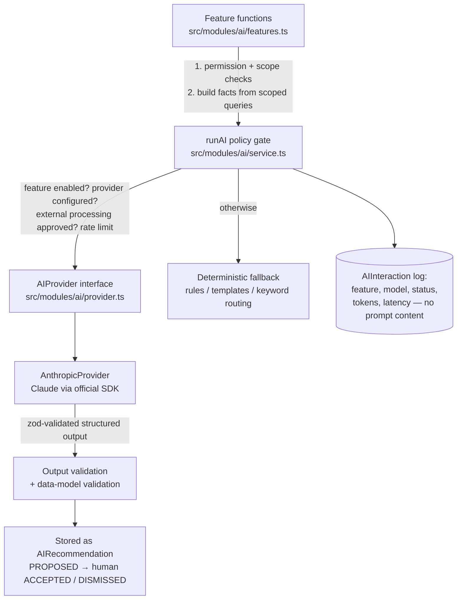

# AI architecture and security boundaries

AI is integrated into the core workflows but is **advisory only**. It never approves, rejects, assigns, closes or edits records. Every feature has a deterministic fallback, so the platform remains fully functional with `AI_PROVIDER=disabled`.

## Layers

- **Provider-agnostic:** business code depends only on `AIProvider` (`generateJson`, `generateText`). The Anthropic implementation uses the official `@anthropic-ai/sdk`, structured outputs (`output_config.format` with a Zod schema), adaptive thinking, explicit effort, server-side refusal fallbacks, a request timeout (`AI_TIMEOUT_MS`) and one retry. Default model: `claude-opus-5-5` (`AI_MODEL`). Additional providers implement the same interface and are registered in `getAIProvider()`.
- **Policy gate (`runAI`):** a call reaches the provider only if (1) the feature switch in `ai.features` is on, (2) a provider is configured, (3) the data-governance setting `ai.externalProcessingApproved` is true, and (4) the per-user hourly limit is not exceeded. Otherwise, or on timeout/refusal/schema failure, the deterministic fallback runs and the UI states which source produced the result.

## Features

| # | Feature | AI path | Deterministic fallback | Human control |
|---|---|---|---|---|
| 1 | Request classification | Category/department codes, urgency indicators, risks, missing info, assessment questions | Keyword overlap with category descriptions, service's suggested department, completeness checks | Suggestion panel only; triage form is separate |
| 2 | Request quality | Score + issues + suggestions | Length/vagueness/measurability checks | Advisory |
| 3 | Planning assistant | Work breakdown, milestones, risks, skills, testing, documentation | Category templates | Stored as draft; **Adopt** creates milestones/tasks (audited) |
| 4 | Assignment recommendations | — (transparent scoring) | Skill match 40, spare capacity 30, department 15, on-time history 15 (neutral when history insufficient) | Recommendation list; manager assigns |
| 5 | Risk prediction | — (explainable rules) | Overdue, progress lag, overdue milestones, blockers, scope churn, unacknowledged assignments, high risks, remediation | Flags with reasons; no accuracy claimed |
| 6 | Executive briefing | Interpretation + recommended actions | Template summary from the same facts | Facts and interpretation shown side by side |
| 7 | Natural-language analytics | Chooses one function + parameters from a fixed catalogue (Zod enum) | Keyword router | Executes only scoped, predefined functions; never SQL |
| 8 | Report drafting | Executive summary draft | Template sentence from report data | Draft stored separately; officer edits; **Finalise** records the human-approved summary |
| 9 | Knowledge repository | — | PostgreSQL full-text search over authorised documents | Publishing requires a second knowledge manager |
| 10 | Duplicate / pattern detection | — | Token Jaccard similarity; cross-MDA clusters | Labelled "indicator, not proof" |
| 11 | Capacity & demand | — | Server-side aggregates | Analytical only, separate from personnel evaluation |
| 12 | Assistant | Answers from retrieved sources with citations | Lists the most relevant retrieved sources | Cannot act; citations filtered to provided sources |

## Security boundaries

| Threat | Control |
|---|---|
| Data leakage across MDAs/roles | Facts and retrieval are built **only** from permission-scoped queries (`requestScope`, `projectScope`, `knowledgeScope`) before any prompt is constructed; tests assert that the assistant does not surface another MDA's records. |
| Prompt injection via request text or documents | Record content is wrapped in `<untrusted_record>` tags with `<`/`>` neutralised; the system prompt states that such content is data and must never be followed; outputs are schema-validated; model output never triggers actions. Uploaded document contents are not sent to the model. |
| Unauthorised tool use | No tools are exposed to the model. Analytics uses a closed enum of functions executed server-side with the user's scope. |
| Hallucinated values | Classification codes are re-validated against the database; assistant citations are filtered to supplied source ids; briefings show raw facts separately. |
| Cost / abuse | Per-user hourly limit, timeouts, low effort for routine features, usage logged with token counts in `AIInteraction` (Admin › System health). |
| Unapproved external processing | Disabled by default (`ai.externalProcessingApproved=false`); the setting is audited and requires `system.ai.configure`. |
| Training on government data | The platform does not opt into any training use; confirm provider data-handling terms (retention, region) before approval. |
| Sensitive personal attributes | Assignment scoring uses only skills, workload, department and delivery history; no personal characteristics; no employment decisions. |

## Enabling AI in production

1. Obtain written approval for the provider, data processing terms and retention.
2. Set `AI_PROVIDER=anthropic`, `AI_API_KEY`, optionally `AI_MODEL`, `AI_TIMEOUT_MS`, `AI_MAX_CALLS_PER_USER_PER_HOUR`.
3. In Admin › System settings, turn on `ai.externalProcessingApproved` and choose the enabled features in `ai.features`.
4. Monitor usage and fallbacks in Admin › System health.
