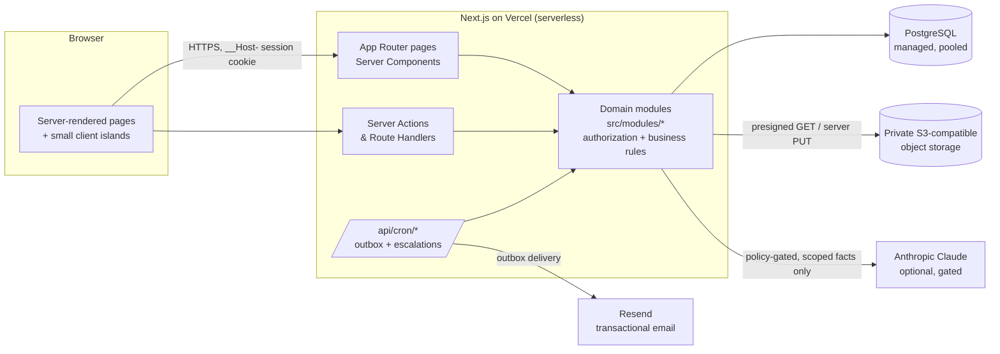
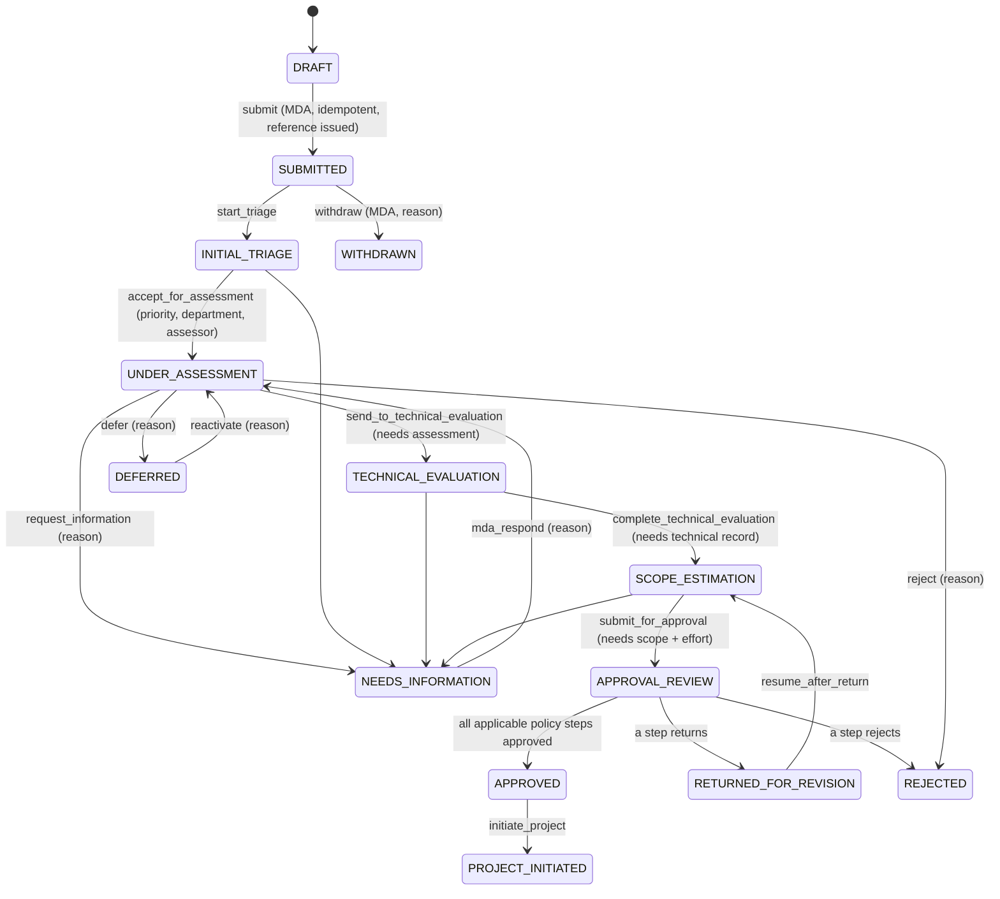

# Architecture

## 1. Overview

KATDICT-SPIMP is a **modular monolith**: one Next.js application deployed as serverless functions, one PostgreSQL database, one private object-storage bucket, one transactional email provider and an optional AI provider. All business rules and authorization live in server-side domain modules (`src/modules/*`); pages and server actions are thin adapters.

### Design principles applied

- **Server-side authorization everywhere.** Every service function receives an `Actor` (user + effective permissions + MDA/department context) and checks permissions *and* row-level scope (`src/modules/rbac/scope.ts`). UI visibility is a convenience only.
- **Actions, not statuses.** Clients submit workflow *actions*; the server derives the next status from state-machine tables (`requests/workflow.ts`, `projects/workflow.ts`) and rejects invalid transitions.
- **Transactions + optimistic concurrency.** Related writes (status change + history + audit + notification intent) commit atomically. Mutable aggregates carry a `version`; stale updates fail with a conflict.
- **Separate status concepts.** Request review status, project execution status and project acceptance status are distinct fields.
- **Outbox for side effects.** Emails are queued in `OutboxEvent` inside the business transaction and delivered later with retries; no email is sent inside a database transaction.
- **Append-only history.** `AuditEvent`, `RequestStatusHistory` and `ProjectStatusHistory` reject `UPDATE` (and audit rejects `DELETE`) via database triggers; audit events are SHA-256 hash-chained.
- **No invented data.** Reports, dashboards and AI briefings are computed from records; missing values are shown as "Not recorded". No official MDA names, contact details, holidays or approval thresholds are assumed — they are configuration.

## 2. Module boundaries

| Module (`src/modules/…`) | Responsibility |
|---|---|
| `auth` | Passwords (Argon2id), sessions, tokens (email verification / reset), TOTP MFA + recovery codes, login lockout, current-actor resolution |
| `rbac` | Permission catalogue, default role matrix, `Actor` loading, `can/assert` helpers, row-level scope builders |
| `mdas` | Registration, directory claim, KATDICT review, activation, suspension, profile, invitations, members, verified CSV import |
| `catalog` / `admin/catalog` | Service categories & definitions, SLA targets, priority rules, approval policies |
| `requests` | Drafts, idempotent submission & references, review workflow, assessments, approvals, comments |
| `approvals` | Pure approval-policy evaluation (thresholds, step sequencing) |
| `projects` | Initiation, assignment & acknowledgement, execution workflow, milestones/tasks/dependencies, progress, work logs, risks, blockers, deliverables, communications, change control, completion review, MDA acceptance, closure |
| `sla` | Business calendar and paused-time SLA computation |
| `reports` | Automatic project completion report, Government Reporting Center templates, PDF/CSV rendering |
| `analytics` | Scoped aggregate metrics, scorecard (with definitions), workload, trends, statewide map, demand |
| `intelligence` | Explainable risk rules, similarity / duplicate & shared-solution detection |
| `quality` | Early Warning Centre, Data Quality Centre, scheduled escalations |
| `ai` | Provider abstraction, policy gate, guardrails, AI features with deterministic fallbacks |
| `notifications` | Notification catalogue, in-app notifications, preferences, email providers, outbox processing |
| `files` | Signature-based type detection, private storage drivers, upload/download authorisation |
| `feedback` | Ratings and complaints |
| `knowledge` | Knowledge repository with visibility-filtered full-text search |
| `search` | Permission-filtered global search |
| `audit` | Hash-chained audit writer, verification, audit search, decision trail |
| `settings` | Typed, validated system settings with defaults |
| `admin/users` | User roles/status, staff profiles, role permission editing with guardrails, departments |

## 3. Roles

Eight roles (Super Administrator, Director/DG, Operations Administrator, Department Head, Project Manager/ICT Officer, MDA Administrator, MDA Staff, Auditor) map to 72 permissions. Code checks permissions, never role names (except for safeguards around the Super Administrator role itself). The full matrix is generated from code: [PERMISSION_MATRIX.md](PERMISSION_MATRIX.md).

Notable decisions:
- The **Super Administrator** administers the system but holds no operational approval permissions (separation of duties).
- The **Director/DG** has executive approval, exceptional closure and executive analytics; does not bypass MFA or audit.
- **Privileged roles** (Super Admin, Director, Operations Admin) must enrol TOTP MFA when `security.requireMfaForPrivileged` is on (default).
- MDA users' permissions are reduced to profile editing until their MDA is approved **and** activated; suspended MDAs lose all permissions.

## 4. End-to-end workflow

### Request review workflow (`src/modules/requests/workflow.ts`)

Approval policies are data (`ApprovalPolicy` / `ApprovalStep`). A step applies when it has no thresholds or when **any** threshold (min priority, min estimated cost, min effort) is met. Steps are decided in sequence, each by a different person, and the officer who prepared the scope cannot approve it. The default policy (technical → departmental → executive when priority ≥ HIGH, cost ≥ ₦50m or effort ≥ 90 days) uses **placeholder thresholds** that KATDICT must confirm.

### Project execution + acceptance (`src/modules/projects/*`)

```mermaid
stateDiagram-v2
  [*] --> APPROVED: initiate (from approved request)
  APPROVED --> PLANNING: start_planning
  PLANNING --> AWAITING_ACKNOWLEDGMENT: assign (department, PM, officers)
  AWAITING_ACKNOWLEDGMENT --> ASSIGNED: PM acknowledges
  ASSIGNED --> IN_PROGRESS: start_work (assigned team)
  IN_PROGRESS --> BLOCKED: mark_blocked / blocker
  BLOCKED --> IN_PROGRESS: resume
  IN_PROGRESS --> ON_HOLD: put_on_hold (manager)
  ON_HOLD --> IN_PROGRESS: resume
  IN_PROGRESS --> UNDER_REVIEW: submit completion (milestones done, required deliverables submitted)
  UNDER_REVIEW --> AWAITING_MDA_ACCEPTANCE: KATDICT review approves (reviewer not on team)
  UNDER_REVIEW --> IN_PROGRESS: evidence requested / returned / rejected
  AWAITING_MDA_ACCEPTANCE --> ACCEPTED: MDA accepts
  AWAITING_MDA_ACCEPTANCE --> IN_PROGRESS: MDA rejects / reports incomplete (remediation)
  ACCEPTED --> CLOSED: close (not by team; deliverables accepted) → completion report
  IN_PROGRESS --> CLOSED: close_exceptional (DG permission + justification, audited)
  IN_PROGRESS --> CANCELLED: cancel (manager, reason)
```

`acceptanceStatus` tracks the completion submission separately: `NOT_SUBMITTED → UNDER_KATDICT_REVIEW → (RETURNED_FOR_CORRECTION | AWAITING_MDA) → (ACCEPTED | DISPUTED)`. Every completion submission and acceptance decision is preserved.

**Progress** is never typed by officers; it is derived (`projects/progress.ts`) from milestones and tasks using the configurable `progress.method` (HYBRID default: weighted milestones with partial credit from tasks).

### SLA

Service-level targets are configured per category with per-service overrides. Elapsed time is computed from status history in **working days** using a configurable business calendar (working weekdays + gazetted holidays maintained by administrators). Time in `NEEDS_INFORMATION`, `DEFERRED` and `DRAFT` is **paused** (attributed to the MDA / deliberate deferral) and reported separately.

## 5. Authentication

- Passwords: Argon2id (m=19 MiB, t=2, p=1), 12+ characters with mixed case and digits; timing-equalised verification for unknown accounts.
- Sessions: 256-bit random token in an `HttpOnly; Secure; SameSite=Lax; __Host-` cookie; only `SHA-256(token)` stored. Idle timeout (default 60 min) and absolute lifetime (default 12 h). A new session is issued on every login and MFA completion (no fixation). Password change/reset, role change and suspension revoke sessions.
- MFA: TOTP (RFC 6238) with AES-256-GCM-encrypted secrets and ten single-use recovery codes (hashed). Enforced for privileged roles.
- Abuse protection: PostgreSQL-backed rate limits on login (per IP and per account), registration, reset, verification resend, MFA, uploads, search and AI; account lockout after N failures (configurable); every attempt recorded in `LoginAttempt`; lockouts audited.
- Generic error messages prevent account enumeration (login, reset, registration).
- CSRF: Server Actions enforce same-origin (Next.js Origin check); route handlers that mutate check `Origin`; cookies are `SameSite=Lax`.
- Open redirects: `next` parameters are restricted to same-origin relative paths.
- SSO: the session layer is independent of the credential check (`login()` → `createSession()`), so an OIDC/SAML identity provider can be added as another credential source that maps to existing users and roles.

## 6. Background processing on serverless

Vercel has no long-running workers, so the platform uses a **transactional outbox** + **scheduled functions**:
- `/api/cron/outbox` (every 5 min) delivers queued emails using `FOR UPDATE SKIP LOCKED` claims, exponential backoff, `DEAD` after 6 attempts, admin retry path (Admin › Notification queue).
- `/api/cron/escalations` (hourly) escalates unacknowledged assignments, approaching/overdue deadlines and unanswered clarifications; idempotent via notification dedupe keys.
Both require `Authorization: Bearer $CRON_SECRET`. On Vercel Hobby, crons run at most daily; use Pro or an external scheduler (GitHub Actions, cron-job.org) calling the same endpoints.

## 7. Assumptions (documented defaults)

| Area | Assumption |
|---|---|
| Users ↔ MDAs | A user belongs to at most one MDA. |
| MDA staff submissions | Allowed by default; each MDA administrator can restrict submissions to administrators (`staffMaySubmit`). |
| KATDICT departments | Seven editable default departments; not an approved organisational chart. |
| Approval thresholds | Placeholders (HIGH priority / ₦50m / 90 days) pending management confirmation. |
| Calendar | Mon–Fri working days, WAT (UTC+1); **no holidays pre-loaded** (must be configured). |
| Revision after return | A returned request goes back to KATDICT scope estimation; the MDA can be asked for information separately. |
| Clarification response | Returns the request to `UNDER_ASSESSMENT` regardless of which stage asked (per the specified diagram). |
| File size | 4 MB default (Vercel request-body limit ≈4.5 MB); uploads stream through the server so the file signature can be verified before storage. |
| Malware scanning | Integration point provided (`MALWARE_SCAN_WEBHOOK_URL`); without a scanner, files are marked `NOT_SCANNED`. |
| Search | PostgreSQL full-text search; semantic/vector search is a documented extension (pgvector). |
| Geography | No coordinates assumed; the "statewide map" is an MDA tile map until verified location data exists. |
| Notification templates | Code-defined catalogue with per-user preferences; mandatory security/administrative notices cannot be disabled. |

## 8. Extensibility

New domain areas are added as modules with their own service functions taking an `Actor`, plus permissions in `rbac/permissions.ts` (seeded idempotently). New AI providers implement `AIProvider`. New storage or email providers implement `StorageDriver` / `EmailProvider`. New report templates are added to `reports/periodic.ts`.
