# Database design

PostgreSQL schema managed by Prisma (`prisma/schema.prisma`) with explicit migrations in `prisma/migrations/`. Integrity rules Prisma cannot express (append-only triggers, CHECK constraints, full-text indexes) are in `20261011163900_integrity_controls/migration.sql`.

## Entity–relationship diagram

```mermaid
erDiagram
  User ||--o{ UserRole : holds
  Role ||--o{ UserRole : granted
  Role ||--o{ RolePermission : has
  Permission ||--o{ RolePermission : in
  User ||--o{ Session : has
  User ||--o{ VerificationToken : has
  User |o--o| MdaMembership : "belongs to (max 1)"
  Mda ||--o{ MdaMembership : members
  Mda ||--o{ Invitation : invites
  Mda |o--o{ Mda : "supervises"
  Department ||--o{ User : members
  Department |o--|| User : "head"

  ServiceCategory ||--o{ ServiceDefinition : contains
  ApprovalPolicy ||--o{ ApprovalStep : "ordered steps"
  ApprovalPolicy |o--o{ ServiceDefinition : governs
  Department |o--o{ ServiceDefinition : "suggested for"

  Mda ||--o{ ServiceRequest : submits
  ServiceDefinition ||--o{ ServiceRequest : "requested as"
  User ||--o{ ServiceRequest : creates
  ServiceRequest ||--o{ RequestStatusHistory : "append-only"
  ServiceRequest ||--o{ RequestAssessment : assessed
  ServiceRequest ||--o{ ApprovalDecision : decided
  ApprovalStep ||--o{ ApprovalDecision : "for step"
  ServiceRequest ||--o{ RequestComment : messages
  ServiceRequest ||--o{ Attachment : documents
  ServiceRequest ||--o| Project : "becomes (1:1)"

  Project ||--o{ ProjectStatusHistory : "append-only"
  Project ||--o{ ProjectAssignment : team
  Project ||--o{ ProjectMilestone : milestones
  Project ||--o{ ProjectTask : tasks
  ProjectMilestone |o--o{ ProjectTask : groups
  ProjectTask ||--o{ TaskDependency : "depends on"
  Project ||--o{ ProjectWorkLog : logs
  Project ||--o{ ProjectComment : communications
  ProjectComment ||--o{ CommentRead : "read by"
  Project ||--o{ ProjectDeliverable : deliverables
  ProjectDeliverable ||--o{ Attachment : evidence
  Project ||--o{ ProjectRisk : risks
  Project ||--o{ ProjectBlocker : blockers
  Project ||--o{ ScopeChangeRequest : "change control"
  Project ||--o{ CompletionSubmission : "completion cycles"
  CompletionSubmission ||--o{ AcceptanceDecision : "MDA decisions"
  Project ||--o| ProjectClosure : closure
  Project ||--o{ ReportRecord : "versioned reports"
  Project ||--o{ Feedback : ratings
  Mda ||--o{ Complaint : raises
  Project |o--o{ KnowledgeDocument : "lessons"

  User ||--o{ Notification : receives
  User ||--o{ NotificationPreference : sets
  AuditEvent }o--|| AuditEvent : "prevHash chain"
```

Standalone tables: `OutboxEvent` (email outbox), `AuditEvent` (append-only, hash-chained), `Counter` (reference sequences), `RateLimitBucket`, `LoginAttempt`, `AIInteraction`, `AIRecommendation`, `SystemSetting`.

## Key relationships and rules

| Relationship / rule | Why |
|---|---|
| `Project.requestId` is **unique** | Each approved request yields exactly one project; the request's review history stays with the request. |
| `ServiceRequest.status`, `Project.status`, `Project.acceptanceStatus` are separate enums | Review, execution and acceptance are different concepts. |
| `ServiceRequest.reference`, `Project.reference` unique; allocated from `Counter` inside the submitting transaction | Human-readable, gap-free for committed transactions, never timestamp-based. |
| `ServiceRequest.submissionKey` unique | Idempotent submission (duplicate clicks return the same request). |
| `version` on `ServiceRequest`, `Project`, `Mda` | Optimistic concurrency on workflow transitions. |
| `ApprovalDecision (requestId, stepId, cycle)` unique | One decision per step per approval cycle; cycles increment on each re-entry into review. |
| `CompletionSubmission (projectId, cycle)` unique | Every completion attempt is preserved through remediation. |
| `ProjectClosure.projectId` unique | Single closure record (standard or exceptional with justification). |
| `ReportRecord (type, projectId, version)` unique | Reports are versioned snapshots; finalised versions are immutable in the app. |
| `ScopeChangeRequest.originalScope` | Approved scope is never silently overwritten; history of changes is retained. |
| `Attachment.storageKey` random UUID; owner FKs (`requestId`/`projectId`/`deliverableId`/…) | Unguessable keys; authorisation derived from the parent record. |
| `MdaMembership.userId` unique | Assumption: a user belongs to one MDA. |
| `Notification (userId, dedupeKey)` unique | Idempotent scheduled notifications. |

### Deletion behaviour

Business records use `onDelete: Restrict` for references that must never dangle (requests → MDA/service/creator, projects → request, decisions → step, closures, audit integrity). Child collections of an aggregate cascade (e.g. milestones of a project), but projects and submitted requests are never deleted by the application; only drafts can be deleted by their creator. Users are deactivated rather than deleted.

### Integrity controls (raw SQL migration)

- Triggers reject `UPDATE`/`DELETE` on `AuditEvent` and `UPDATE` on the two status-history tables.
- CHECK constraints: ratings 1–5, risk likelihood/impact 1–5, progress 0–100, positive weights, work-log hours 0–24, no self-dependency, positive attachment size.
- GIN full-text indexes on knowledge documents, request titles/problems and project titles/descriptions.

### Indexes

Indexes support the dominant access paths: `(mdaId, status)` on requests and projects, `(departmentId, status)` on projects, `(assigneeId, status)` on assignments/tasks, `(status, expectedAckBy)` for escalations, `(status, nextAttemptAt)` for the outbox, `(entityType, entityId)` and `(createdAt)` on audit events, `(userId, readAt)` on notifications.

### Retention

`AuditEvent` is retained for at least `retention.auditYears` (default 10). Archival is a DBA procedure (export to WORM storage, verify chain, then purge under change control with the trigger temporarily disabled by a database owner) — see SECURITY.md. Read notifications older than `retention.notificationDays` may be purged. Operational records (requests, projects, reports) are official records and are not purged by the application.
